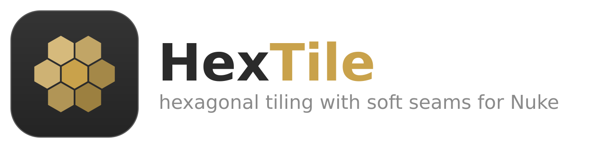
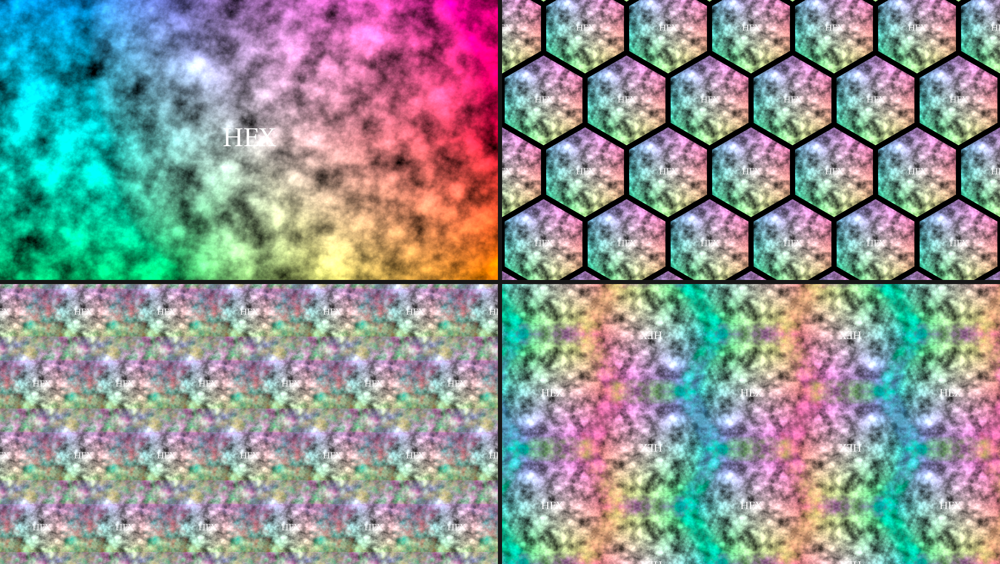

<p align="center">
  <picture>
    <source media="(prefers-color-scheme: dark)" srcset="docs/wordmark_dark.png">
    
  </picture>
</p>

# HexTile

**The native Tile node, on a grid of hexagons, with soft seams.**

Created by **Gabin Vidal** · v1.0 · <https://www.linkedin.com/in/gabinvidal>

> 🇫🇷 **La version française se trouve [plus bas](#hextile-fr).**


<sub>Top left: the source. Top right: 6 columns with a gap. Bottom left: 6 columns, seam falloff 0.6 (the seams disappear). Bottom right: flat top, mirrored columns and rows, falloff 0.25.</sub>

HexTile repeats its input in hexagonal cells, the way Tile does with rectangles. You keep the controls you know from Tile (columns, rows, mirror) and get a **seam falloff** slider on top: at 0 the cells meet on a clean antialiased edge, and as you raise it the neighbouring cells blend into each other across the seams.

## Features

- **Pointy top or flat top** hexagons.
- **Columns / rows** with a **mirror** switch for each, like Tile. With **regular hexagons** on (the default), rows follows columns so the cells stay regular; turn it off to set rows by hand.
- **Seam falloff**: 0 gives sharp seams (antialiased, never aliased), 1 blends across the whole cell. Corners where three cells meet blend the three of them.
- **Gap**: empty space between the cells, black with alpha 0, for honeycomb looks or to use as a matte.
- **Fit**: *Fill* keeps the aspect of the image and crops it to the cell, *Stretch* squeezes it into the cell like Tile does.
- **Content scale** and **grid offset**: zoom the image inside each cell (below 1 it repeats), move the grid in pixels.
- **Mask** input, **mix**, an **Info** tab that explains every knob, and an **About** tab.
- One self-contained `HexTile.gizmo`. The work is done by a BlinkScript kernel, so it runs on the GPU when there is one.

## Requirements

- Nuke 16 or newer: Nuke, NukeX or Nuke Studio. Tested on Nuke 16.0v4 and 17.0v3, Nuke and NukeX (Windows).
- BlinkScript is disabled in Nuke Non-commercial, so HexTile doesn't run there.
- Optional: a GPU for BlinkScript (set in Preferences, it falls back to the CPU).

## Install

1. Copy `HexTile.gizmo` into your `~/.nuke` folder, or any folder in your Nuke plugin path.
2. In Nuke, Tab-search `HexTile`.

Optional menu entry with its icon: also copy `icons/HexTile.png` into `~/.nuke`, then add this to `~/.nuke/menu.py`:

```python
nuke.menu('Nodes').addCommand('Transform/HexTile', "nuke.createNode('HexTile')", icon='HexTile.png')
```

## Usage

Inputs: **src** (the image to tile) and **mask**.

| Knob | Effect |
|---|---|
| **orientation** | `Pointy Top`: rows are offset by half a cell. `Flat Top`: columns are offset. |
| **fit** | `Fill` keeps the aspect of the image and crops it to the cell. `Stretch` squeezes it into the bounding box of the cell. |
| **columns** | Number of cells across the width. Fractional values are allowed. |
| **rows** | Number of cells over the height. Greyed out while `regular hexagons` is on. |
| **mirror** | Flips every other column (next to columns) or every other row (next to rows). |
| **regular hexagons** | On: rows is computed from columns so the hexagons stay regular. Off: rows is free and the hexagons stretch. |
| **seam falloff** | 0 = sharp antialiased seams. Higher values blend the neighbouring cells over a wider band, up to the whole cell at 1. |
| **gap** | Empty space between the cells (black, alpha 0). |
| **content scale** | Zoom of the image inside each cell. Below 1 the image repeats inside the cell. |
| **grid offset** | Moves the grid, in pixels. |
| **mask / mix** | Limit and mix the result over the input, like any merge-type node. |

**Tips**

- For a texture that must not show its repetition, use a low number of columns, a falloff around 0.3 to 0.5, and play with `grid offset`.
- `gap` plus a Shuffle of the alpha gives you a clean honeycomb matte.
- With `mirror` on rows and columns, an image with strong edges stays continuous across more of the seams.

## Build from source

The kernel lives in `src/HexTile.blink`. `src/build_hextile.py` builds the Group, compiles the kernel and exports `HexTile.gizmo` next to `src/`. It needs NukeX, since only NukeX compiles BlinkScript:

```bat
"C:\Program Files\Nuke17.0v3\Nuke17.0.exe" -t --nukex src\build_hextile.py
```

## Known limitations

- **Bilinear filtering only.** Tile lets you pick a filter; HexTile always samples bilinearly.
- **The output covers the format of the input.** Anything outside the input's bounding box reads as black.
- **Pixel aspect is ignored**: on anamorphic plates the hexagons follow the pixels, not the display.
- **Editing the kernel needs NukeX.** Running the gizmo doesn't.

## Credits

Created by **Gabin Vidal**, <https://www.linkedin.com/in/gabinvidal>.

## License

MIT, see `LICENSE`.

---

# HexTile (FR)

**Le node Tile natif, en grille d'hexagones, avec des joints adoucis.**

Créé par **Gabin Vidal** · v1.0 · <https://www.linkedin.com/in/gabinvidal>

HexTile répète son input dans des cellules hexagonales, comme Tile le fait avec des rectangles. On garde les réglages de Tile (columns, rows, mirror) et on gagne un curseur **seam falloff** : à 0 les cellules se touchent sur un bord net et antialiasé, et plus on le monte, plus les cellules voisines se fondent les unes dans les autres au niveau des joints.

## Fonctions

- Hexagones **pointe en haut** ou **plat en haut**.
- **Columns / rows** avec un **mirror** pour chacun, comme Tile. Avec **regular hexagons** (actif par défaut), rows suit columns pour garder des hexagones réguliers ; on le décoche pour régler rows à la main.
- **Seam falloff** : 0 donne des joints nets (antialiasés), 1 fond toute la cellule. Aux coins où trois cellules se touchent, les trois se mélangent.
- **Gap** : un espace vide entre les cellules, noir avec alpha 0, pour un look nid d'abeille ou pour s'en servir de matte.
- **Fit** : *Fill* garde le ratio de l'image et la recadre dans la cellule, *Stretch* l'écrase dedans comme Tile.
- **Content scale** et **grid offset** : zoom de l'image dans chaque cellule (en dessous de 1 elle se répète), décalage de la grille en pixels.
- Input **mask**, **mix**, un onglet **Info** qui explique chaque knob et un onglet **About**.
- Un seul fichier `HexTile.gizmo`. Le calcul est fait par un kernel BlinkScript, donc sur le GPU s'il y en a un.

## Pré-requis

- Nuke 16 ou plus récent : Nuke, NukeX ou Nuke Studio. Testé sur Nuke 16.0v4 et 17.0v3, en Nuke et en NukeX (Windows).
- BlinkScript est désactivé dans Nuke Non-commercial : HexTile n'y tourne pas.
- Optionnel : un GPU pour BlinkScript (réglé dans les Préférences, sinon le CPU prend le relais).

## Installation

1. Copier `HexTile.gizmo` dans le dossier `~/.nuke`, ou dans n'importe quel dossier du plugin path de Nuke.
2. Dans Nuke : Tab puis `HexTile`.

Pour avoir une entrée de menu avec l'icône : copier aussi `icons/HexTile.png` dans `~/.nuke`, puis ajouter la ligne de la [section Install](#install) dans `~/.nuke/menu.py`.

## Utilisation

Inputs : **src** (l'image à répéter) et **mask**. Le détail de chaque knob est dans le [tableau Usage](#usage) et dans l'onglet Info du node.

**Conseils**

- Pour une texture qui ne doit pas montrer sa répétition : peu de colonnes, un falloff entre 0,3 et 0,5, et jouer sur `grid offset`.
- `gap` suivi d'un Shuffle de l'alpha donne un matte nid d'abeille propre.
- Avec `mirror` sur les rangées et les colonnes, une image aux bords marqués reste continue sur plus de joints.

## Limites connues

- **Filtrage bilinéaire uniquement** : Tile permet de choisir un filtre, pas HexTile.
- **La sortie couvre le format de l'input** : ce qui est hors de la bounding box de l'input est lu comme du noir.
- **Le pixel aspect est ignoré** : sur une image anamorphique, les hexagones suivent les pixels et pas l'affichage.
- **Modifier le kernel demande NukeX**, pas l'utiliser.

## Licence

MIT, voir `LICENSE`.
